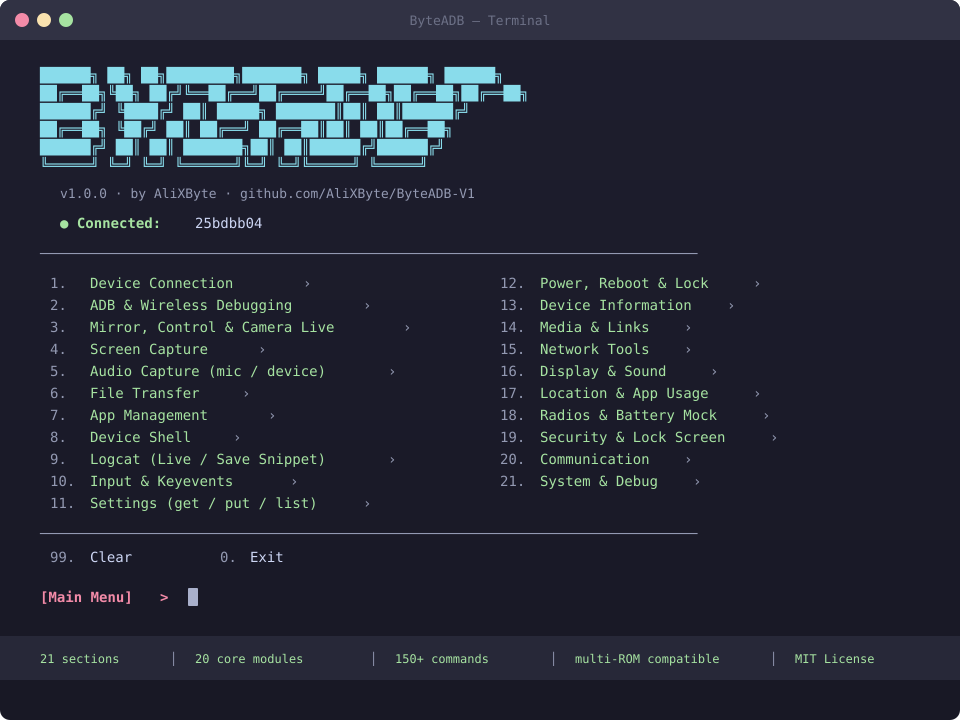
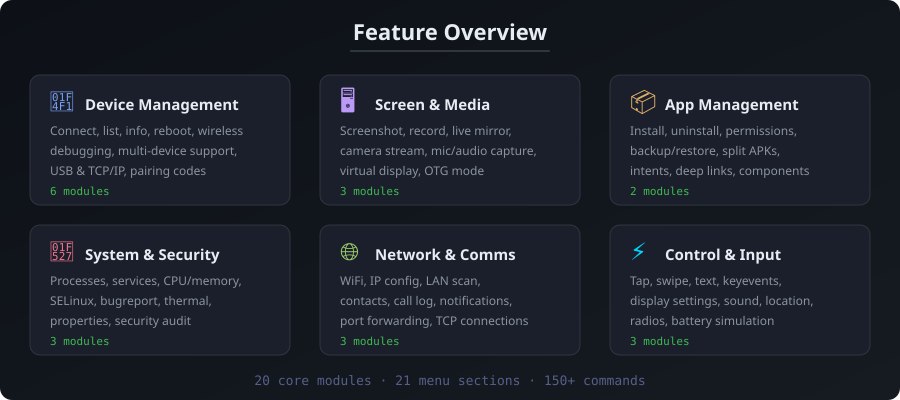

<p align="center">
  
</p>

<p align="center">
  <a href="#">
    
  </a>
</p>

<p align="center">
  
  
  
  
</p>

<p align="center">
  
  
  
  
</p>

---

<br>

> *Most ADB "helper" tools are either a single Python script with a handful of hardcoded commands, or a GUI app that hides what it's actually running. ByteADB is neither.*

ByteADB is a proper CLI for scripting **and** a full-screen terminal dashboard for everything else — files, apps, logcat, shell, screen, input, settings, wireless — all built on the real `adb` binary, never a reimplementation of the protocol.

**V1 is CLI/TUI only, on purpose.** A web panel is planned as a separate V2 product.

<br>

## 🖥️ Preview

<p align="center">
  
</p>

<br>

## ⚡ Quick Install

```bash
git clone https://github.com/AliXByte/ByteADB-V1.git
cd ByteADB-V1
pip install -r requirements.txt
python3 byteadb.py
```

> You'll also need [Android Platform Tools](https://developer.android.com/tools/releases/platform-tools) (`adb`) on your PATH.

<br>

## 🧠 Why ByteADB?

<table>
<tr>
<td width="50%">

### 🔧 One Interface
Stop memorizing `pm`, `am`, `settings`, `dumpsys` flags — ByteADB wraps them all in a clean numbered menu.

### 🛡️ Safe Multi-Device
Every command is pinned to one serial. A second phone plugged in mid-session can't make you run something on the wrong device.

</td>
<td width="50%">

### 💀 Honest Errors
A failed command shows the exact `adb` invocation and its real stderr — not a swallowed exception.

### 📱 ROM Compatible
Multi-fallback strategies that work on Xiaomi/MIUI, Samsung OneUI, Huawei EMUI, and stock Android alike.

</td>
</tr>
</table>

<br>

## ⚔️ Features

<p align="center">
  
</p>

<br>

## 📋 The Dashboard

Running `byteadb` with no arguments opens the interactive numbered dashboard:

```
 1. Device Connection ›               12. Power, Reboot & Lock ›
 2. ADB & Wireless Debugging ›        13. Device Information ›
 3. Mirror, Control & Camera Live ›   14. Media & Links ›
 4. Screen Capture ›                  15. Network Tools ›
 5. Audio Capture (mic / device) ›    16. Display & Sound ›
 6. File Transfer ›                   17. Location & App Usage ›
 7. App Management ›                  18. Radios & Battery Mock ›
 8. Device Shell ›                    19. Security Check ›
 9. Logcat (Live / Save Snippet) ›    20. Communication ›
10. Input & Keyevents ›               21. System & Process Manager ›
11. Settings (get / put / list) ›

99. Clear     0. Exit
```

<br>

## 🚀 Usage

```bash
python3 byteadb.py                       # interactive menu
python3 byteadb.py devices list          # list attached devices
python3 byteadb.py devices info          # model, Android version, battery
python3 byteadb.py files ls /sdcard      # browse device files
python3 byteadb.py apps list --user-only # list installed apps
python3 byteadb.py logcat tail --level W # live logcat with filter
python3 byteadb.py screen shot photo.png # take screenshot
```

> Install as a command: `pip install -e .` → then use `byteadb` directly.

<br>

## 📦 Command Reference

| Group | Commands |
|:---|:---|
| `devices` | `list`, `info`, `reboot` |
| `files` | `ls`, `mkdir`, `rm`, `mv`, `push`, `pull` |
| `apps` | `list`, `info`, `install`, `uninstall`, `clear`, `force-stop`, `enable`, `disable`, `launch`, `grant`, `revoke` |
| `shell` | run one command, or drop into interactive shell |
| `logcat` | `tail` (with `--level`/`--tag` filters), `clear` |
| `screen` | `shot`, `record`, `mirror` (via scrcpy) |
| `control` | `tap`, `swipe`, `text`, `key`, `reboot` |
| `settings` | `get`, `put`, `list` (system/secure/global) |
| `wireless` | `pair`, `connect`, `disconnect`, `enable-tcpip` |

> Every device-scoped command accepts `--serial/-s` to target a specific phone.

<br>

## 🏗️ Project Structure

```
ByteADB/
├── byteadb.py              # entry point
├── byteadb/
│   ├── core/               # 20 modules — pure logic, talks to adb
│   │   ├── adb.py            # process wrapper, device listing
│   │   ├── apps.py           # install, uninstall, permissions, launch
│   │   ├── communication.py  # contacts, call log, calendar, notifications
│   │   ├── control.py        # tap, swipe, text, keyevent, reboot
│   │   ├── display.py        # brightness, resolution, density
│   │   ├── files.py          # ls, mkdir, rm, mv, push, pull
│   │   ├── location.py       # GPS mock, geolocation
│   │   ├── logcat.py         # streaming logcat with filters
│   │   ├── media.py          # media files, URLs
│   │   ├── network.py        # wifi, IP, LAN scan, port forwarding
│   │   ├── radios.py         # airplane, wifi/bt/nfc, battery mock
│   │   ├── screen.py         # screenshot, record, scrcpy mirror
│   │   ├── security.py       # security audit, SELinux
│   │   ├── settings.py       # get/put/list across namespaces
│   │   ├── sms.py            # SMS operations
│   │   ├── sysinfo.py        # cpu, memory, storage, thermal
│   │   ├── system.py         # processes, services, bugreport
│   │   ├── usage.py          # app usage, battery stats
│   │   └── wireless.py       # pairing, tcpip mode
│   ├── cli/
│   │   ├── main.py           # Click CLI entry
│   │   └── menu.py           # interactive menu (2000+ lines)
│   └── tui/
│       └── app.py            # Textual dashboard
├── tests/
├── pyproject.toml
├── requirements.txt
└── LICENSE
```

<br>

## 🔒 Security

ByteADB only does what `adb` itself can already do on an authorized, debugging-enabled device — it doesn't exploit anything, bypass Android's permission model, or talk to a phone that hasn't explicitly authorized this computer's RSA key.

<br>

## 📜 License

Released under the [MIT License](LICENSE).

<br>

---

<p align="center">
  <strong>Designed and built by <a href="https://github.com/AliXByte">AliXByte</a></strong>
</p>

<p align="center">
  
</p>
